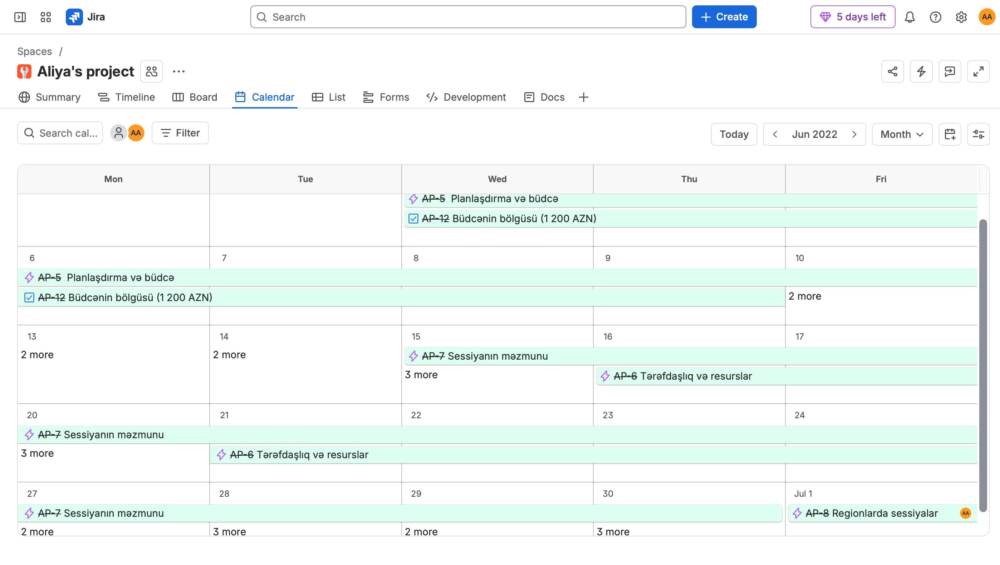
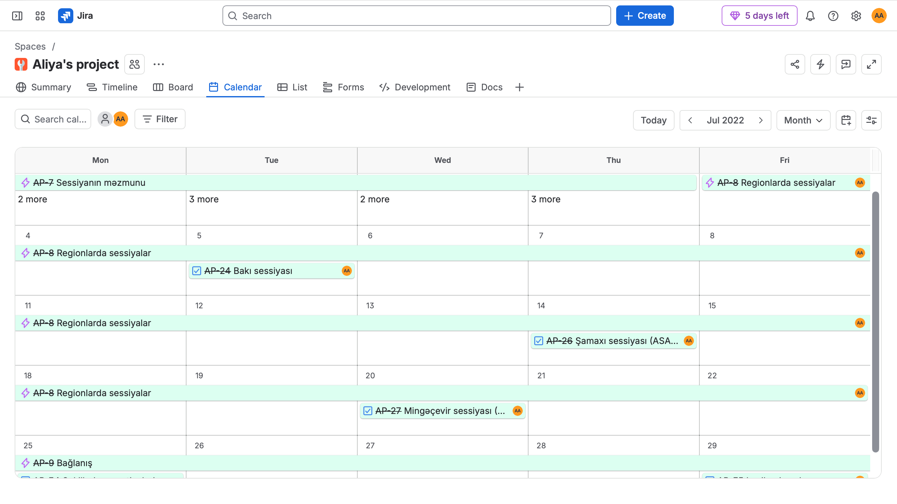
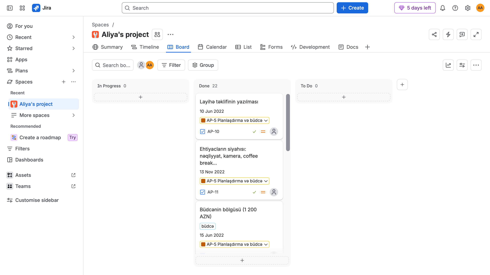
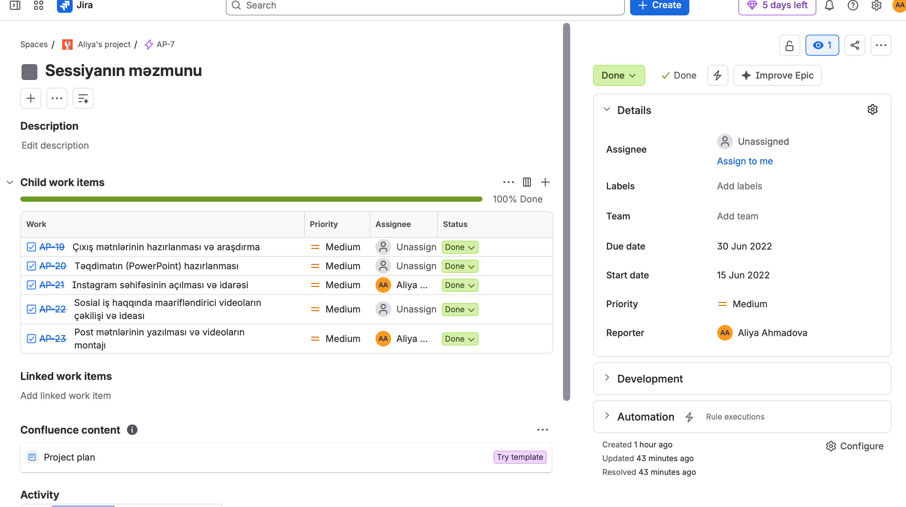
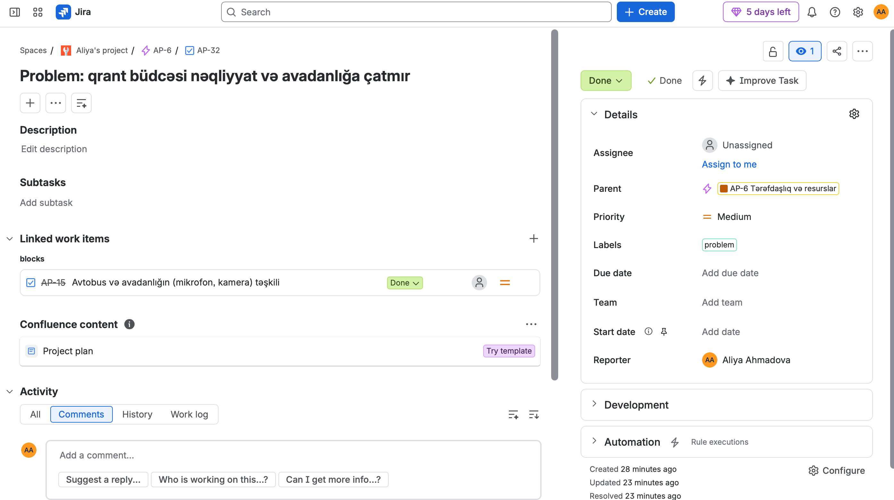
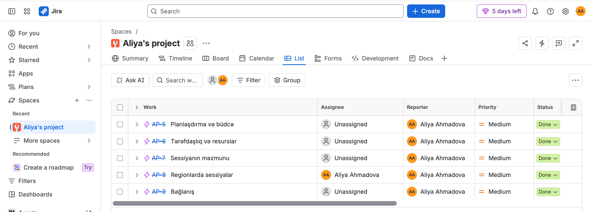

# Jira Case Study: "From School to Social Work" Awareness Project

A completed, grant-funded awareness project (July 2022) rebuilt in Jira to document how it was planned, delivered and closed: phases, tasks, responsibilities, problems and lessons learned.

> The project took place in 2022. The Jira board was built retrospectively in 2026 as a portfolio case study, using the real scope, timeline, budget and team roles.

---

## Project overview

| | |
|---|---|
| **Goal** | Explain to secondary school students (grades 9–11) what social work is, what the degree covers and what career paths it offers |
| **Team** | 4 people: a lawyer (proposal writing, photography, technical support) and three social workers (trainers) |
| **Locations** | Baku, Sumgayit, Shamakhi, Mingachevir |
| **Sessions** | 4 sessions, July 2022 |
| **Grant budget** | 1,200 AZN |
| **In-kind sponsor** | ASAN Service: bus, fuel, microphone and camera |

## My role

- **Trainer:** co-delivered the awareness sessions in all 4 cities.
- **SMM lead:** created and managed the project's Instagram page, wrote post copy and edited the awareness videos.
- **Jira case study:** designed and built this Jira project, including the workflow configuration, issue tracking and lessons learned.

## Budget

| Item | Calculation | Amount |
|---|---|---|
| Coffee breaks | 4 sessions × 100 AZN | 400 AZN |
| Trainer fees | 3 trainers × 250 AZN | 750 AZN |
| Contingency | Materials for ice-breaking games, unexpected costs | 50 AZN |
| **Total** | | **1,200 AZN** |

Transport and equipment were not covered by the grant. They were secured through an in-kind sponsorship (see *Problems and solutions*).

## Jira structure

The project is organised into **5 epics**, **22 tasks** and **4 subtasks** (31 work items in total).

| Epic | Key tasks | Dates (2022) |
|---|---|---|
| 1. Planning and budget | Proposal writing, needs list, budget breakdown, city selection | 1–15 Jun |
| 2. Partnerships and resources | Sponsorship negotiation, transport and equipment, venues, outreach to schools and courses | 16–30 Jun |
| 3. Session content | Speech research and writing, presentation, Instagram page, awareness videos, post copy and video editing | 15–30 Jun |
| 4. Regional sessions | Sessions in Baku, Sumgayit, Shamakhi and Mingachevir (with subtasks for venue, coffee break, delivery and photography) | 1–22 Jul |
| 5. Closure | Sharing results with the sponsor, lessons learned | 23–31 Jul |

**Jira features used**

- Epic → Task → Subtask hierarchy
- Assignees, due dates, start dates and labels
- **Workflow configuration:** added *To Do* and *Done* statuses and set the initial status, after the default workflow allowed only *In Progress*
- Work item links (*blocks*, *relates to*) to connect problems with the work they affected
- Comments to document solutions and lessons learned
- Board, List and Calendar views

## Problems and solutions

| Problem | Impact | Jira link | Solution |
|---|---|---|---|
| The grant budget did not cover transport and equipment | Blocked the transport and equipment task | *blocks* | An in-kind sponsorship from ASAN Service covered the bus, fuel, microphone and camera. The grant was used for coffee breaks, trainer fees and a contingency reserve. |
| In Shamakhi, some students had been brought to the session by teachers against their will and wanted to prepare for exams | Affected the Shamakhi session | *relates to* | We talked openly with the students and explained why choosing a degree matters, and respected voluntary participation by letting those who wanted to leave go. For later sessions, voluntary participation was agreed with schools in advance. |

## Lessons learned

1. Keeping a contingency reserve in the budget made it possible to handle unexpected costs.
2. In-kind sponsorship can close resource gaps in small-budget projects.
3. Agreeing on voluntary participation with schools in advance improves session quality.
4. Keeping all stakeholders (donor, sponsor, schools) informed of changes reduces project risk.

## Screenshots

### Calendar: June 2022 (preparation phases)

### Calendar: July 2022 (regional sessions)

### Board: all 22 tasks completed

### Epic: Session content

### Problem tracking with linked work items

### List view: 5 epics, all Done

---

**Tools:** Jira Cloud (Free plan) · **Author:** Aliya Ahmadova · [LinkedIn](https://www.linkedin.com/in/aliya-ahmedova)
